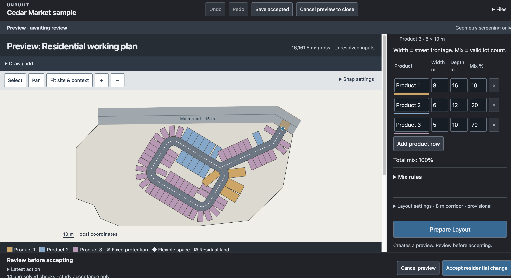

# Unbuilt

### Explore a better master plan before committing to it.

**Created by an architect and master planner**, Unbuilt is a browser-based workspace for early residential master planning. It brings site constraints, streets, housing lots, open space and measured development trade-offs into one place, with planning assistance from **Muse AI by Meta**.

**[Open the demo](https://unbuilt-blond.vercel.app)**



*A residential layout preview with product mix controls, unresolved checks and an explicit review before acceptance.*

## The difficult problem Unbuilt tackles

A master plan is a connected set of decisions. Adding homes can require more road. Shortening a street can remove usable frontage. Protecting a landscape feature can change the buildable area. A different housing mix can affect both the layout and its financial assumptions.

These relationships are difficult to explore when drawings, spreadsheets and design discussions live separately. Each revision requires quantities to be checked again, constraints to be remembered and alternatives to be compared on the same basis. A persuasive-looking plan can still contain inaccessible lots, overlapping land allocations or unresolved assumptions.

Unbuilt helps an architect, planner or development team work through those consequences while the plan is still flexible. The aim is to make early decisions easier to inspect, explain and revise.

## Highlights

- **Plan around real commitments.** Define the boundary, entrance, adjoining roads, protected features and flexible spaces. Keep fixed requirements visible while exploring changes.
- **Prepare connected residential layouts.** Test streets and lots against the site's geometry, product dimensions and housing-mix targets.
- **Understand land efficiency.** Review lot counts, lot area, road length, road area, open space and residual land. Explore whether remaining areas can accommodate existing housing products.
- **Keep geometry and assumptions connected.** Inspect the effect of supported layout changes and recorded cost inputs. Missing cost scopes and unresolved checks remain explicit.
- **Review before accepting.** Preview a proposal, inspect its measured differences, accept or cancel it, and compare saved alternatives without losing the accepted plan.
- **Ask Muse about the current plan.** Request an explanation or a supported experiment in ordinary language, with the current selection and planning context attached.
- **Keep work portable.** Save projects in the browser and export or import project files for later study.

## Muse AI and Meta Technologies

Unbuilt uses Meta's Muse model family in two distinct roles:

| Role | Model | Contribution |
| --- | --- | --- |
| AI-assisted development | **Meta Muse Spark 1.3** — `muse-spark-1.3` | Supports implementation, prototyping and iteration on the architect's planning workflows. |
| In-app planning intelligence | **Meta Muse Wonder 1.0** — `muse-wonder-1.0` | Interprets planning requests, selects supported tools and helps explain the current plan through the Meta Model API. |

These are the Muse Spark and Muse Wonder model names documented in the [Meta Model API model catalogue](https://dev.meta.ai/docs/models).

### How Muse helped make Unbuilt

The architect and master planner supplies the design intent, practical constraints and criteria for judging an alternative. Muse Spark assists the development process by helping translate those requirements into working software, explore implementation approaches and refine interactions as the planning workflow develops.

That collaboration connects professional planning experience with AI-assisted software development: the brief comes from the discipline, and the application evolves around the decisions a planner needs to make.

### How Muse works inside the app

Muse Wonder receives a bounded planning context: the current scenario, selected object, commitments and measured findings. It can request clarification, explain relevant findings or propose a supported action, such as testing a higher-yield layout, reducing road length, adjusting product allocations or exploring residual land.

The planning engine validates the proposed action and calculates its geometry and quantities. The user reviews the resulting trial before accepting a change. Numerical findings come from the engine, and locked commitments are checked independently of the model's response.

This gives natural-language assistance a concrete connection to the drawing and its measurements, while keeping the architect or planner in control of the accepted design.

**Demo availability:** the public demo connects to Meta Muse Wonder 1.0 through the server-side Meta Model API integration. Direct planning and calculations remain available independently of the AI connection.

## Try the workflow

1. Open a sample or create a project and define its boundary.
2. Record the entrance, adjoining road, protected spaces and housing products.
3. Set the mix and street requirements, then prepare a layout.
4. Inspect the measured results and unresolved checks before accepting it.
5. Save an alternative, compare it with the accepted study, or ask Muse to investigate a supported change when connected.

## Future work

The following are planned directions, rather than features available in the current demo:

- **Connect land-parcel GIS.** Bring cadastral parcels and surrounding spatial layers into the workflow through [OGC API – Features](https://www.ogc.org/standards/ogcapi-features/) and GeoJSON. Use [PostGIS](https://postgis.net/) for spatial storage and queries, with a path to QGIS interoperability. Preserve coordinate reference systems, source dates and data provenance when moving between survey coordinates and mapped parcels.
- **Explore the plan in 3D.** Add terrain, building massing, street sections and surrounding context using [CesiumJS](https://cesium.com/platform/cesiumjs/), with 3D Tiles and glTF as candidate formats. Keep the 2D plan and 3D view connected to the same scenario.
- **Deepen site and infrastructure analysis.** Extend terrain, drainage and infrastructure studies with better source data and discipline-specific checks.
- **Strengthen development appraisal.** Expand cost coverage, phasing and sensitivity analysis, with clear attribution to the assumptions used.
- **Support shared review.** Add shared project storage, comments and a decision history for architects, planners, engineers and development teams.

## Run locally

Use Node.js 24 and npm. Install the planning-engine and web dependencies:

```sh
npm ci
npm --prefix web ci
```

Start the API and web app in separate terminals:

```sh
node --experimental-strip-types --no-warnings server/intent.mjs
```

```sh
npm --prefix web run dev
```

For Muse, configure `UNBUILT_MODEL_KEY`, `UNBUILT_MODEL_URL` and `UNBUILT_MODEL` on the server. The Wonder connection uses `https://api.meta.ai/v1/chat/completions` and `muse-wonder-1.0`. Keep the API key out of browser code and version control.

## Scope

Unbuilt is an early planning and geometry-screening tool. Its findings depend on supplied inputs, implemented checks and recorded assumptions. Survey verification, statutory approval, engineering design and a complete development appraisal remain separate professional tasks.
